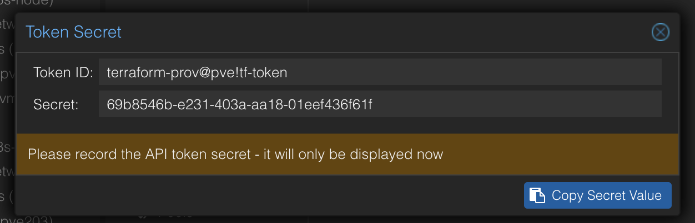

# Create Proxmox VM/Container with Terraform

自前のProxmox環境にVMやコンテナを立てるためのTerraformフレームワーク。  
基本的なコマンドは、Makefileに集約し、基礎となる環境ファイルは`template`ディレクトリに格納している。  
公式のドキュメントは[こちら](https://registry.terraform.io/providers/Telmate/proxmox/latest/docs/guides/cloud-init%2520getting%2520started)。  
Proxmox Providerのリポジトリは[こちら](https://github.com/Telmate/terraform-provider-proxmox)。

# Version情報

- Terraform: v1.9.8
- Proxmox VE: 8.3.0
- Proxmox Provider: 3.0.2-rc01 (VM・LXC共通)
- Ubuntu Template: 24.10
 
# Gettig Started

## 1. Terraformをインストール

```sh
$ terraform version
Terraform v1.9.8
```

## 2. Proxmox API Tokenの取得

まず、以下のようにロール、ユーザーを作成し、作成したロールをユーザーに割り当てる。
以下のコマンドはPVEクラスタのノード上であればどこで実行しても良い。
また、GUIでも作成可能だがRoleは多少面倒なのでRoleだけはコマンドで作成するのがおすすめ。

### TerraformProvロールの作成

```sh
$ pveum role add TerraformProv -privs "Datastore.AllocateSpace Datastore.Audit Pool.Allocate Sys.Audit Sys.Console Sys.Modify VM.Allocate VM.Audit VM.Clone VM.Config.CDROM VM.Config.Cloudinit VM.Config.CPU VM.Config.Disk VM.Config.HWType VM.Config.Memory VM.Config.Network VM.Config.Options VM.Migrate VM.Monitor VM.PowerMgmt SDN.Use"
```

### terraform-provユーザーの作成

```sh
$ pveum user add terraform-prov@pve --password <password>
```

### TerraformProvロールをterraform-provユーザーに割り当てる

```sh
$ pveum aclmod / -user terraform-prov@pve -role TerraformProv
```

最後に作成したユーザーを用いてGUI上で任意のidでトークンを作成する。
以下のような画面が出ればOK



## Provider情報の設定

- TOKENをべたがきするようになっているため、流出に注意

```sh
# モジュールレベルに設定（後方互換性のため）
$ make setup-provider

# または、特定の環境に設定（推奨）
$ make setup-provider ENV=<環境名>
```

作成された`provider.tf`にProxmox API Tokenの情報を記述する

## VMテンプレートの作成

以下のコマンドをproxmoxのノード上で実行する
スクリプトは[こちら](https://qiita.com/ymbk990/items/bd3973d2b858eb86e334)を参考にしました。  
コピペ用は[こちら](./scripts/create-vm-template.sh)。

```bash
$ wget https://cloud-images.ubuntu.com/oracular/current/oracular-server-cloudimg-amd64.img -O ubuntu-24.10-server-cloudimg-amd64.img
# Base VM configuration
$ qm create 9200 --net0 virtio,bridge=vmbr0
$ qm importdisk 9200 ubuntu-24.10-server-cloudimg-amd64.img local-lvm
$ qm set 9200 --name ubuntu-24.10a
$ qm set 9200 --scsihw virtio-scsi-pci --virtio0 local-lvm:vm-9200-disk-0
$ qm set 9200 --boot order=virtio0
$ qm set 9200 --ide2 local-lvm:cloudinit
$ qm set 9200 --nameserver 127.0.0.53 --searchdomain localdomain
# Convert VM to VM Template
$ qm template 9200
```

## 目的毎にTerraformの設定ファイル(env)を作成する

- 以下のコマンドでenvを作成する

```bash
$ make create-vm ENV=<VM_NAME>
$ make create-ct ENV=<CT_NAME>
```

`envs/<ENV_NAME>/terraform.tfvars`を適宜編集する
以下はざっくりした説明

- hostname : VMのホスト名
- username : VMにログインするユーザ名
- public_key : VMにログインするための公開鍵
- cores : CPUのコア数
- memory : メモリのサイズ (MB)
- disk_size : ディスクのサイズ (GB)
- ip_address : VMに割り当てるIPアドレス
- gateway : VMに割り当てるゲートウェイ
- target_node : Proxmoxのノード名
- template : VMのテンプレート名
- storage : VMのストレージ名
- bride : VMに割り当てるネットワークブリッジ
- vmid : VMのID

## Terraform環境の適用方法

```sh
# 環境を初期化
$ make init ENV=<ENV_NAME>

# 実行計画を確認
$ make plan ENV=<ENV_NAME>

# リソースを作成
$ make apply ENV=<ENV_NAME>

# リソースを削除（必要な場合）
$ make destroy ENV=<ENV_NAME>

# 環境一覧を表示
$ make list
```

# ヘルプとドキュメント

```sh
# 利用可能なコマンド一覧
$ make help
```

## ドキュメント

- [MIGRATION.md](./MIGRATION.md) - Taskfileからの移行ガイド
- [template/vm/README.md](./template/vm/README.md) - VM環境の詳細
- [template/container/README.md](./template/container/README.md) - Container環境の詳細
- [docs/create_vm_template.md](./docs/create_vm_template.md) - VMテンプレートの作成方法

## 参考

- [Proxmox VEとTerraformでインターン生に仮想マシンを払い出す話](https://qiita.com/ymbk990/items/bd3973d2b858eb86e334)
